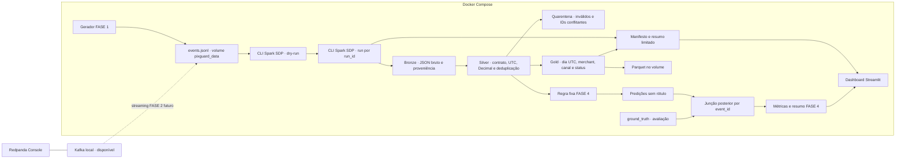

# Plano do PixGuard AI

**Estado:** FASE 0, FASE 1 e o processamento offline da FASE 3 estão integrados e validados em containers. A FASE 2
de streaming Kafka continua planejada. A FASE 4 está implementada e validada em containers como entrega separada,
com baseline e métricas sintéticas.

## Objetivo e escopo

Construir um laboratório educacional reproduzível para explorar eventos de pagamento Pix fictícios, Kafka,
Spark Declarative Pipelines (SDP), qualidade de dados e detecção experimental por regras/modelo. O MVP não usa
transações reais, não processa pagamentos e não representa um antifraude de produção.

MVP: gerador sintético de **100.000 eventos** com seed 42; contrato versionado; caminho offline por fixture;
Kafka no `docker-compose.yml`; camadas Bronze/Silver/Gold em diretórios locais num volume Docker compartilhado;
regras explicáveis; dashboard web local com marcação de dados simulados. Toda execução de código, Spark, testes e interface ocorre dentro de
containers. ML é opcional e só vem depois da qualidade/reprodutibilidade. Estatísticas agregadas do Banco Central
podem contextualizar o projeto em gráficos separados.

## O que existe / o que falta / como comprovar

| Existe | Falta | Como comprovar |
|---|---|---|
| FASE 0 de arquitetura e FASE 1 de infraestrutura, gerador, painel e Redpanda Console | streaming Kafka segue planejado; a FASE 3 processa o JSONL offline | Issues #1–#14 e relatórios locais ignorados em `specs/` |
| Gerador produz 100.000 eventos sintéticos versionados em JSONL | integração automática do gerador com Kafka | teste do gerador na Issue #2; FASE 2 ainda planejada |
| Pipeline Spark SDP 4.3.0 no perfil Compose `pipeline` | Kafka streaming e garantias de entrega | dry-run, fixture, lote 100k e segunda execução na Issue #10 |
| Bronze, Silver, quarentena, Gold, manifesto e resumo dashboard em volume Docker | política de retenção/limpeza de execuções | outputs sob `runs/<run_id>` e leitores em container |
| Dashboard mostra o manifesto concluído mais recente e resumo Gold | painel Kafka/streaming integrado | testes e resposta HTTP local da Issue #11 |
| Baseline fixa, avaliação de 100 mil registros e métricas no dashboard | ML e dados representativos de fraude real | relatórios locais das Issues #16–#18; runs imutáveis `eval-003` e `eval-004` |
| Estatísticas agregadas do Banco Central como fonte opcional futura | verificar utilidade, fonte, licença e formato antes de qualquer uso | não são requisito para o fluxo sintético offline |

## Arquitetura proposta



O `docker-compose.yml` contém `kafka`, `app`, `dashboard` e `pipeline`; o Spark é opt-in pelo perfil `pipeline`.
Um volume Docker nomeado em `/data/pixguard` mantém o JSONL, os Parquet e os manifestos. O fluxo de processamento
da FASE 3 começa no arquivo da FASE 1 e não lê Kafka. Kafka e Redpanda Console continuam disponíveis para
inspeção manual, mas o gerador ainda não publica no broker.

O runtime Spark é uma imagem separada com Python 3.12, Java 17 e PySpark com SDP 4.3.0. Cada `run_id` cria um
diretório e warehouse isolados; o dashboard escolhe o manifesto concluído válido com `finished_at` UTC mais
recente e consome um resumo limitado a 20 grupos. A tela não inicializa Spark nem carrega o JSONL completo.

O processamento lê o arquivo pelo Spark, sem materializar o conjunto inteiro na memória do driver. O dashboard
e o pipeline executam em containers; o navegador no host é somente cliente visual. Esta arquitetura é local ao
Docker host, não distribuída nem de alta disponibilidade.

### Esboço da primeira tela

```text
┌ PixGuard AI · DEMONSTRAÇÃO · DADOS 100% SINTÉTICOS ─────────────────┐
│ Gerador: aguardando │ Volume: local │ Dados: sintéticos │ Atualizar │
├────────────────────┬───────────────────┬────────────────────────────┤
│ Eventos produzidos │ Eventos solicitados │ Estado                     │
│ 0                  │ 100.000             │ aguardando                 │
├────────────────────────────────────────────────────────────────────┤
│ Progresso: 0% │ última atualização: — │ duração: — │ erro: —      │
└────────────────────────────────────────────────────────────────────┘
```

O dashboard lê o estado persistido pelo gerador e distingue uma execução concluída de estados vazios ou com erro.
Na FASE 3, também mostra contagens, resumo Gold e alertas de execução falha. Na FASE 4, o dashboard valida
manifesto e hashes e mostra matriz de confusão, métricas, baseline negativa e exemplos limitados. Gráficos de
streaming só entram depois de existir uma fonte Kafka/streaming validada.

## Contrato e segurança de dados

Contrato implementado `payment_event_v1`: `event_id` UUID; hashes fictícios de conta/dispositivo; merchant; valor decimal BRL;
`event_time`/`ingested_at` UTC; região fictícia; canal, status, schema_version, `label_is_synthetic` e cenário.
Proibidos CPF, nome, conta e chave Pix reais. `ground_truth` não entra nas features de predição. Bronze preserva
linhas brutas e metadados; Silver valida, representa horários em UTC e dinheiro como Decimal, deduplica e
põe inválidos e conflitos em quarentena. Gold conta eventos e soma BRL por dia UTC, comerciante, canal e status;
não produz alertas nem usa `ground_truth` na agregação.

## Fontes e armazenamento

- Banco Central: estatísticas agregadas poderão ser consideradas como contexto visual separado. Antes do uso,
  verificar fonte, licença, formato e disponibilidade. Elas não são necessárias para o gerador ou testes offline.
- Eventos do projeto: 100% sintéticos, seed 42, sem dado pessoal; fixtures pequenas versionáveis.
- PaySim: opcional, fora do MVP; origem, licença e viés exigem avaliação antes de inclusão.
- Armazenamento das saídas: filesystem local no volume Docker nomeado. O caminho `/data/pixguard` deve ser
  compartilhado por app, pipeline e dashboard; separar subdiretórios de entrada, Bronze/Silver/Gold e checkpoints.

## Runtime e compatibilidade observados

| Componente | Configuração desta entrega | Evidência e limite |
|---|---|---|
| Python | aplicação em `python:3.12.12-slim-bookworm`; pipeline em `python:3.12-slim-bookworm` | builds e testes executados em containers; a tag da pipeline não fixa patch/digest |
| Java e Spark SDP | OpenJDK 17 e `pyspark[pipelines]==4.3.0` no lockfile | dry-run, materialização e consulta Parquet comprovados; conector Kafka ainda não validado |
| Kafka e Redpanda Console | `apache/kafka:4.4.0` e Console `v3.14.0` no Compose | infraestrutura entregue na PR #8; publicação/consumo automáticos, replay e atraso seguem na FASE 2 |
| Filesystem Docker | volume nomeado em `/data/pixguard` | arquivos consultados em containers novos; retenção e backup permanecem responsabilidades locais |
| Docker Compose | serviços Kafka, Console, app, pipeline e dashboard | configuração e healthchecks validados; Spark usa perfil `pipeline` com 2 CPUs e 4 GiB |

## Orçamento de recursos

O lote de aceite é 100.000 eventos. O gerador e o pipeline devem processar em lotes ou fluxo, com fixtures
menores para ciclos rápidos. Cada serviço tem limites de recursos no Compose; as fases de processamento devem
medir o consumo e ajustar esses limites antes de aumentar o volume de dados.

## Experiência visual

A tela mostra progresso real do gerador, totais, estado e um aviso permanente de dados sintéticos. A seção
FASE 3 apresenta contagens reconciliadas e até vinte grupos Gold. Estados vazios, falhos e inválidos têm
mensagens próprias. Saúde do streaming e alertas analíticos dependem de entregas posteriores.

## Riscos e decisões

- Spark SDP 4.3.0, Java 17 e Python 3.12 foram comprovados no fluxo offline. A compatibilidade do conector
  Kafka e o comportamento de streaming ainda exigem uma PoC própria da FASE 2.
- Fontes externas podem mudar formato, licença ou disponibilidade. Mitigação: manter BCB opcional e verificar as
  condições antes de qualquer integração.
- Volume compartilhado é local ao Docker host e precisa de espaço, permissões e backup explícitos; não é storage
  distribuído nem ambiente de alta disponibilidade. Isso é aceitável para o laboratório local.
- Rótulos artificiais podem produzir métricas enganadoras. Mitigação: seed e protocolo de avaliação
  justificado para a hipótese, dados congelados e aviso de que métricas descrevem o simulador.
- Garantias de entrega variam com source, checkpoint e sink. Mitigação: testar replay, explicar limites e evitar
  afirmação ampla de exactly-once.
- Como o repositório é público, revisar cada entrega para manter segredos, dados reais e artefatos locais fora
  do histórico. Documentação, código e configuração são publicados em entregas com escopo definido.

ADRs registrados incluem armazenamento em volume Docker local, execução em containers, dados sintéticos
reproduzíveis e execução Spark por `run_id`. A ADR 0005 da baseline permanece proposta; a implementação dos
defaults didáticos não equivale a aprovação de política. A decisão de quarentenar todos os IDs conflitantes foi
confirmada por Rafael. Streaming, checkpoints e qualquer hipótese de modelo exigem decisões e validações próprias.

## Backlog por fases

### Rastreabilidade no GitHub

Cada mudança de código deve ter uma Issue que descreva o trabalho. Entregas de código, testes, configuração e
documentação são organizadas em Pull Requests vinculadas às Issues e validadas antes da integração.

1. FASE 0: auditoria e plano local (concluída).
2. Fundamental: consolidar requisitos/arquitetura (`PLAN-001`, Issue #4; concluída).
3. FASE 1: Compose base (`INFRA-001`, Issue #1), contrato/gerador de 100 mil eventos (`GEN-001`, Issue #2), dashboard (`UI-001`, Issue #3) e Redpanda Console para inspeção visual do broker (`INFRA-002`, Issue #6).
4. FASE 2: integrar publicação/consumo Kafka e estudar replay, idempotência, atraso/quarentena e painel de streaming; broker e Console já existem na infraestrutura da PR #8.
5. FASE 3: processamento SDP offline, Bronze/Silver/Gold, consulta visual e execução reproduzível.
6. FASE 4: baseline fixa, avaliação, painel e documentação (`RULE-001` #16, `ANALYSIS-001` #17,
   `UI-003` #18 e `DOCS-003` #19); o artigo `ARTICLE-002` #20 é preparado localmente. Comparação ML somente se justificada.
7. FASE 5: hardening, execução E2E totalmente em Docker, README/runbook e série editorial final.

Cada fase terá Issue, critérios, validação executada em containers, evidências e um artigo próprio. Os artigos
conectam as etapas e incluem somente resultados já verificados.

## Critérios de aceite

- Seed 42 reproduz exatamente 100.000 eventos e IDs conforme a configuração declarada.
- Fixture injeta duplicatas, atrasos, eventos fora de ordem e inválidos, com tratamento observado e medido.
- Interrupção/retomada não duplica fatos Silver no sink escolhido, ou a limitação observada é documentada.
- SDP executa dry-run e run real com fixture; camadas são consultáveis e reexecução é medida.
- Regras e eventual modelo são avaliados em dados sintéticos congelados sem leakage, com falso positivo explícito.
- Painel, docs e posts sempre rotulam dados simulados e não prometem desempenho em fraude real.
- Testes offline rodam sem acesso ao BCB e posts não são publicados automaticamente.
- `docker compose up` inicia serviços; comandos de aplicação/testes rodam dentro dos containers, sem Python/Spark no host.
- A cada fase, testes passam antes de avançar e o dashboard exibe a capacidade visual concluída.
- Um artigo revisado por fase mantém links de série e contém apenas fatos comprovados daquela fase.

## Roteiro de estudo

1. Contratos, relógios de evento/processamento, UTC, dedupe e reprodutibilidade.
2. Kafka: chave, partição, offset, retenção, replay e consumer lag.
3. Structured Streaming: DataFrames, checkpoints, watermark e semântica do sink.
4. SDP: declarar datasets/fluxos, grafo, tabelas e diferença entre dry-run e execução real.
5. Qualidade, quarentena, métricas e risco de leakage em ML.

## FASE 3: execução e resultados verificados

A FASE 3 transforma o JSONL sintético em arquivos Parquet locais:

- **Bronze** preserva cada linha original e metadados de origem/execução.
- **Silver** valida `payment_event_v1`, usa UTC e valor monetário `Decimal`, mantém uma linha quando o mesmo
  `event_id` aparece com payload equivalente e encaminha registros inválidos ou todos os membros de um grupo
  com payload divergente à quarentena. Rafael confirmou a quarentena integral dos conflitos.
- **Gold** soma BRL como `Decimal` e conta eventos por dia UTC, comerciante, canal e status. A coluna
  `ground_truth` não é usada na agregação.
- **Entrada congelada** é uma cópia incremental de até 1 MiB por bloco, retida em `input-snapshot.jsonl` no run.
  Todas as views leem essa cópia. Alterar o arquivo original durante o processamento impede publicar `completed`.
- **Manifesto** registra `run_id`, SHA-256 da cópia consumida, caminho original, snapshot, versões, contagens,
  reconciliação e caminhos. Só é publicado como concluído após conferir a cópia e a origem; cada execução tem
  warehouse independente.
- **Dashboard** lê a última execução concluída válida, seu manifesto e um resumo de até 20 grupos; erro posterior
  é um aviso e não substitui resultados concluídos.

Na validação com a seed padrão, o gerador escreveu 100.000 registros (55.919.188 bytes). Dois processamentos
em `run_id` separados tiveram Bronze 100.000, Silver 100.000, duplicatas removidas 0, quarentena 0 e Gold 3.269.
Uma comparação em outro container encontrou zero diferenças entre Bronze e Silver (desconsiderando `run_id`) e Gold. A soma BRL observada foi
`245449133.57`. Uma fixture adicional cobriu payload equivalente com whitespace distinto, conflito, JSON inválido
e evento atrasado. Regressões adicionais conferem que um inválido no mesmo ID de dois payloads conflitantes
entra uma única vez na quarentena e que substituir a origem durante/depois do SDP produz `failed`. A validação
da correção passou com 17 testes da pipeline e 122 da app; dois lotes de 100.000 levaram 59,782 s e 60,698 s.
Esses números são resultados reproduzíveis do simulador, não evidência antifraude.

Como nenhum ponteiro `latest` ou política de retenção está implementado, os diretórios de execução crescem até
que a pessoa remova o volume local. `docker compose down` preserva dados; `docker compose down -v` os apaga.
Kafka, streaming, exactly-once, dados reais, modelos de ML e monitoramento de produção continuam fora desta fase.

## FASE 4: baseline e avaliação sintética

A FASE 4 aplica `amount_threshold_v1` 1.0.0: sinalizar quando `amount_decimal >= R$ 10.000,00`. O limite é a
fronteira da classe `high_amount` criada no gerador, não um valor escolhido por treinamento ou política
financeira. O score é o valor em centavos, sem significado de probabilidade. A projeção de entrada do scorer só
contém essa feature; o rótulo é juntado depois que as previsões foram salvas.

Na execução `batch-100k-001`, com seed 42 comprovada pelo manifesto do gerador, houve 100.000 linhas Silver:
5.008 positivos e 94.992 negativos. Dois runs independentes (`eval-003` e `eval-004`) registraram TP=5.008,
FP=0, FN=0, TN=94.992; precision, recall, F1 e PR-AUC foram 1,0. A baseline sempre-negativo teve accuracy
0,94992 e deixou passar os 5.008 positivos. Os dois runs foram logicamente equivalentes em container novo.
As faixas são disjuntas (positivos R$10.000–R$50.000; demais R$1–R$2.000), portanto o resultado perfeito
demonstra apenas conformidade com o simulador.

A origem da FASE 3 não tem checksum histórico de Silver. A FASE 4 congelou um inventário SHA-256 no início e
conferiu o mesmo inventário e manifesto ao final: isso detecta alterações durante a análise, mas não autentica
retroativamente que Silver permaneceu igual desde sua criação.

O dashboard verifica o manifesto e hashes dos artefatos e mostra matriz, métricas, baseline e até vinte
explicações. Ele não importa Spark. Quando um denominador é zero, mostra valor nulo/indefinido com sua razão.
Consulte [o guia de análise](source/guia/analise-fase-4.md) para termos e comandos.

Kafka streaming não está envolvido, ML não foi desenvolvido e não houve avaliação cega nem dados reais. A ADR
0005 permanece `proposed`: os defaults executados são configuração observada para estudo, não decisão de produto
ou aprovação formal de Rafael.

## Resultado da FASE 0

**PASSOU:** auditoria Git/ambiente, pesquisa de arquitetura e planejamento para Docker Compose, volume local,
100 mil eventos sintéticos, execução em containers, interface progressiva e validação incremental como critérios
para as fases de implementação. A FASE 0 não executou código da aplicação.
