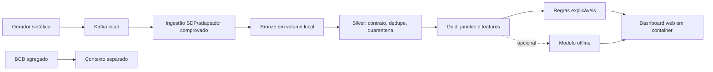

# Plano do PixGuard AI

**Estado:** FASE 1 implementada e validada localmente. As entregas são publicadas por fase, em Pull Requests vinculadas às Issues correspondentes.

## Objetivo e escopo

Construir um laboratório educacional reproduzível para explorar eventos de pagamento Pix fictícios, Kafka,
Spark Declarative Pipelines (SDP), qualidade de dados e detecção experimental por regras/modelo. O MVP não usa
transações reais, não processa pagamentos e não representa um antifraude de produção.

MVP: gerador sintético de **100.000 eventos** com seed 42; contrato versionado; caminho offline por fixture;
Kafka no `docker-compose.yml`; camadas Bronze/Silver/Gold em diretórios locais num volume Docker compartilhado;
regras explicáveis; dashboard web local com marcação de dados simulados. Toda execução de código, Spark, testes e interface ocorre dentro de
containers. ML é opcional e só vem depois da qualidade/reprodutibilidade. Estatísticas agregadas do Banco Central
podem contextualizar o projeto em gráficos separados.

## O que existe / o que falta / como comprovar

| Existe | Falta | Como comprovar |
|---|---|---|
| Repositório público `faelk8/pix_guard` | publicar cada entrega em uma PR com escopo e validação claros | histórico de Issues e PRs |
| FASE 0 documentada e FASE 1 validada localmente; Issues #1–#4 criadas | fases de processamento e análise posteriores | plano, relatórios de validação e Issues correspondentes |
| Aplicação Python 3.12.12 em containers | compatibilidade de Spark com a imagem de execução | testar versões de Java e Spark dentro do container na FASE 3 |
| Estatísticas agregadas do Banco Central são uma fonte opcional futura | verificar utilidade, fonte, licença e formato antes de qualquer uso | não participam do gerador nem dos testes atuais |
| Docker oferece volumes locais persistentes | processamento Spark/Kafka das fases seguintes | persistência e leitura entre containers foram validadas na FASE 1 |
| Documentação oficial SDP atual | versão/ambiente instalado e pipeline real | instalação isolada futura, `dry-run` e `run` com fixture |

## Arquitetura proposta



`docker-compose.yml` define `kafka`, `app`, `dashboard` e `pipeline`. O serviço `pipeline` está reservado para
fases posteriores. Um volume Docker nomeado compartilhado em `/data/pixguard` guarda os eventos e manifestos;
não há serviço S3 adicional. Na FASE 1, o gerador grava os 100 mil eventos no volume, sem mantê-los todos em
memória. O envio ao Kafka e o processamento Spark ainda serão testados em fases próprias, sem presumir garantia
de entrega de ponta a ponta.

Dashboard progressivo: FASE 1 mostra execução/contagem do gerador; FASE 2 mostra Kafka, lag, duplicatas e erros;
FASE 3 permite inspecionar volumes/qualidade Bronze, Silver e Gold; FASE 4 apresenta regras, features e métricas.
O painel e o processamento rodam em containers; navegador no host é apenas cliente visual.

### Primeira tela (FASE 1 implementada)

```text
┌ PixGuard AI · DEMONSTRAÇÃO · DADOS 100% SINTÉTICOS ─────────────────┐
│ Gerador: concluído │ Volume: disponível │ Dados: sintéticos │ Atualizar │
├────────────────────┬───────────────────┬────────────────────────────┤
│ Eventos produzidos │ Eventos solicitados │ Volume gravado              │
│ 100.000            │ 100.000             │ 53.33 MiB                   │
├────────────────────────────────────────────────────────────────────┤
│ Progresso persistido: 100% │ horários UTC │ duração │ erro         │
└────────────────────────────────────────────────────────────────────┘
```

O dashboard lê o manifesto compartilhado e apresenta os estados concluído, em execução, falhou, interrompido,
vazio e inválido. Gráficos de streaming, camadas e alertas entram após as fontes desses dados existirem e
passarem pelos testes da fase correspondente.

## Contrato e segurança de dados

Contrato `payment_event_v1`: `event_id` UUID; hashes de conta/dispositivo sintéticos; merchant; valor decimal BRL;
`event_time`/`ingested_at` UTC; região fictícia; canal, status, schema_version, `label_is_synthetic` e cenário.
Proibidos CPF, nome, conta e chave Pix reais. `ground_truth` não entra nas features de predição. Bronze preserva
envelope e metadados; Silver valida, normaliza, deduplica e põe inválidos em quarentena; Gold agrega por conta e
janela e explica cada alerta.

## Fontes e armazenamento

- Banco Central: estatísticas agregadas poderão ser consideradas como contexto visual separado. Antes do uso,
  verificar fonte, licença, formato e disponibilidade. Elas não são necessárias para o gerador ou testes offline.
- Eventos do projeto: 100% sintéticos, seed 42, sem dado pessoal; fixtures pequenas versionáveis.
- PaySim: opcional, fora do MVP; origem, licença e viés exigem avaliação antes de inclusão.
- Armazenamento das saídas: filesystem local no volume Docker nomeado. O caminho `/data/pixguard` deve ser
  compartilhado por app, pipeline e dashboard; separar subdiretórios de entrada, Bronze/Silver/Gold e checkpoints.

## Matriz preliminar de compatibilidade

| Componente | Estado/hipótese | Próxima prova |
|---|---|---|
| Python | 3.12.12 na imagem da aplicação | verificar compatibilidade com Spark dentro do container na FASE 3 |
| Java e Spark SDP | não fazem parte da imagem atual do pipeline | testar combinações compatíveis antes da integração |
| Kafka | `apache/kafka:4.4.0` em serviço Compose saudável | conectar o gerador e validar entrega, replay e atraso na FASE 2 |
| Filesystem Docker | volume nomeado em `/data/pixguard` | compartilhamento e persistência entre containers validados na FASE 1 |
| Docker Compose | Kafka, aplicação, pipeline reservado e dashboard | configuração validada com `docker compose config --quiet` |

## Orçamento de recursos

O lote de aceite é 100.000 eventos. O gerador e o pipeline devem processar em lotes ou fluxo, com fixtures
menores para ciclos rápidos. Cada serviço tem limites de recursos no Compose; as fases de processamento devem
medir o consumo e ajustar esses limites antes de aumentar o volume de dados.

## Experiência visual

O dashboard da FASE 1 mostra o progresso real do gerador, total produzido e solicitado, volume, duração e estado;
um aviso identifica os dados como sintéticos. As próximas telas poderão apresentar saúde do streaming, qualidade
das camadas e alertas quando essas fontes existirem. A interface não inventa métricas e trata estados vazios ou
erros de leitura explicitamente.

## Riscos e decisões

- Compatibilidade Spark/SDP/Kafka/conector/Java ainda não comprovada. Mitigação: protótipo offline, depois PoC.
- Fontes externas podem mudar formato, licença ou disponibilidade. Mitigação: manter BCB opcional e verificar as
  condições antes de qualquer integração.
- Volume compartilhado é local ao Docker host e precisa de espaço, permissões e backup explícitos; não é storage
  distribuído nem ambiente de alta disponibilidade. Isso é aceitável para o laboratório local.
- Rótulos artificiais podem produzir métricas enganadoras. Mitigação: seed, split temporal, congelamento do teste
  e aviso explícito de que métricas descrevem o simulador.
- Garantias de entrega variam com source, checkpoint e sink. Mitigação: testar replay, explicar limites e evitar
  afirmação ampla de exactly-once.
- Como o repositório é público, revisar cada entrega para manter segredos, dados reais e artefatos locais fora
  do histórico. Documentação, código e configuração são publicados em entregas com escopo definido.

ADRs registrados: armazenamento em volume Docker local, execução em containers e uso de dados sintéticos
reproduzíveis. Decisões futuras incluem a abordagem de processamento Spark, checkpoints e critérios para avaliar
qualquer modelo, depois de estabelecer um baseline.

## Backlog por fases

### Rastreabilidade no GitHub

Cada mudança de código deve ter uma Issue que descreva o trabalho. Entregas de código, testes, configuração e
documentação são organizadas em Pull Requests vinculadas às Issues e validadas antes da integração.

1. FASE 0: auditoria e plano local (concluída).
2. Fundamental: consolidar requisitos/arquitetura (`PLAN-001`, Issue #4; concluída).
3. FASE 1: Compose base (`INFRA-001`, Issue #1), contrato/gerador 100k (`GEN-001`, Issue #2) e dashboard (`UI-001`, Issue #3); concluída e validada localmente.
4. FASE 2: Kafka, filesystem compartilhado, replay, idempotência, atraso/quarentena e painel de streaming.
5. FASE 3: prova SDP no container com Bronze/Silver/Gold no volume local, consulta visual e execução reproduzível.
6. FASE 4: baseline, métricas, painel visual completo e comparação ML apenas se justificada.
7. FASE 5: hardening, execução E2E totalmente em Docker, README/runbook e série editorial final.

Cada fase terá Issue, critérios, validação executada em containers, evidências e um artigo próprio. Os artigos
conectam as etapas e incluem somente resultados já verificados.

## Critérios de aceite

- Seed 42 reproduz exatamente 100.000 eventos e IDs conforme a configuração declarada.
- Fixture injeta duplicatas, atrasos, eventos fora de ordem e inválidos, com tratamento observado e medido.
- Interrupção/retomada não duplica fatos Silver no sink escolhido, ou a limitação observada é documentada.
- SDP executa dry-run e run real com fixture; camadas são consultáveis e reexecução é medida.
- Regras e eventual modelo são avaliados em dados sintéticos congelados sem leakage, com falso positivo explícito.
- Painel, docs e posts sempre rotulam dados simulados e não prometem desempenho em fraude real.
- Testes offline rodam sem acesso ao BCB e posts não são publicados automaticamente.
- `docker compose up` inicia serviços; comandos de aplicação/testes rodam dentro dos containers, sem Python/Spark no host.
- A cada fase, testes passam antes de avançar e o dashboard exibe a capacidade visual concluída.
- Um artigo revisado por fase mantém links de série e contém apenas fatos comprovados daquela fase.

## Roteiro de estudo

1. Contratos, relógios de evento/processamento, UTC, dedupe e reprodutibilidade.
2. Kafka: chave, partição, offset, retenção, replay e consumer lag.
3. Structured Streaming: DataFrames, checkpoints, watermark e semântica do sink.
4. SDP: declarar datasets/fluxos, grafo, tabelas e diferença entre dry-run e execução real.
5. Qualidade, quarentena, métricas e risco de leakage em ML.

## Resultado histórico da FASE 0

**PASSOU:** auditoria Git/ambiente, pesquisa de arquitetura e planejamento para Docker Compose, volume local,
100 mil eventos sintéticos, execução containerizada, UI progressiva e validação incremental.

## Resultado da FASE 1

**PASSOU localmente:** infraestrutura Compose com Kafka 4.4.0 e volume compartilhado; contrato `payment_event_v1`;
geração incremental e reproduzível de 100.000 eventos; manifesto de progresso; dashboard com aviso permanente de
dados sintéticos. `docker compose run --rm app pytest` passou com **100 testes**; a geração real gravou 100.000
linhas e SHA-256 `274d6a0b1543ddd9adfb881428527c0d34ba8870cf541b4254954f90caba110e`; dashboard local respondeu HTTP 200.
Issues #1–#4 registram o planejamento e as dependências das entregas.

**Continuidade:** a FASE 2 conectará o fluxo de eventos ao Kafka e medirá repetição, atraso e falhas. Cada fase
terá critérios, validação e documentação próprios antes de avançar.
