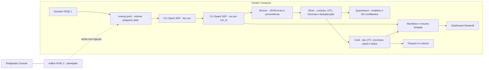

# Plano do PixGuard AI

**Estado:** FASE 0, FASE 1 e o processamento offline da FASE 3 estão implementados localmente e validados em
containers. A FASE 2 de streaming Kafka continua planejada; as entregas da FASE 3 ainda aguardam revisão e
autorização de publicação de Rafael.

## Objetivo e escopo

Construir um laboratório educacional reproduzível para explorar eventos de pagamento Pix fictícios, Kafka,
Spark Declarative Pipelines (SDP), qualidade de dados e detecção experimental por regras/modelo. O MVP não usa
transações reais, não processa pagamentos e não representa um antifraude de produção.

MVP: gerador sintético de **100.000 eventos** com seed 42; contrato versionado; caminho offline por fixture;
Kafka no `docker-compose.yml`; camadas Bronze/Silver/Gold em diretórios locais num volume Docker compartilhado;
regras explicáveis; dashboard web local com marcação de dados simulados. Toda execução de código, Spark, testes e interface ocorre dentro de
containers. ML é opcional e só vem depois da qualidade/reprodutibilidade. Estatísticas agregadas do Banco Central
podem contextualizar o projeto em gráficos separados.

## O que existe / o que falta / como comprovar

| Existe | Falta | Como comprovar |
|---|---|---|
| FASE 0 de arquitetura e FASE 1 de infraestrutura, gerador, painel e Redpanda Console | entrega GitHub de FASE 3 aguarda revisão/autorização | Issues #1–#14 e relatórios locais ignorados em `specs/` |
| Gerador produz 100.000 eventos sintéticos versionados em JSONL | integração automática do gerador com Kafka | teste do gerador na Issue #2; FASE 2 ainda planejada |
| Pipeline Spark SDP 4.3.0 no perfil Compose `pipeline` | Kafka streaming e garantias de entrega | dry-run, fixture, lote 100k e segunda execução na Issue #10 |
| Bronze, Silver, quarentena, Gold, manifesto e resumo dashboard em volume Docker | política de retenção/limpeza de execuções | outputs sob `runs/<run_id>` e leitores em container |
| Dashboard mostra o manifesto concluído mais recente e resumo Gold | painel Kafka/streaming integrado | testes e resposta HTTP local da Issue #11 |
| Estatísticas agregadas do Banco Central como fonte opcional futura | verificar utilidade, fonte, licença e formato antes de qualquer uso | não são requisito para o fluxo sintético offline |

## Arquitetura proposta



O `docker-compose.yml` contém `kafka`, `app`, `dashboard` e `pipeline`; o Spark é opt-in pelo perfil `pipeline`.
Um volume Docker nomeado em `/data/pixguard` mantém o JSONL, os Parquet e os manifestos. O fluxo de processamento
da FASE 3 começa no arquivo da FASE 1 e não lê Kafka. Kafka e Redpanda Console continuam disponíveis para
inspeção manual, mas o gerador ainda não publica no broker.

O runtime Spark é uma imagem separada com Python 3.12, Java 17 e PySpark com SDP 4.3.0. Cada `run_id` cria um
diretório e warehouse isolados; o dashboard escolhe o manifesto concluído válido com `finished_at` UTC mais
recente e consome um resumo limitado a 20 grupos. A tela não inicializa Spark nem carrega o JSONL completo.

O processamento lê o arquivo pelo Spark, sem materializar o conjunto inteiro na memória do driver. O dashboard
e o pipeline executam em containers; o navegador no host é somente cliente visual. Esta arquitetura é local ao
Docker host, não distribuída nem de alta disponibilidade.

### Esboço da primeira tela

```text
┌ PixGuard AI · DEMONSTRAÇÃO · DADOS 100% SINTÉTICOS ─────────────────┐
│ Gerador: aguardando │ Volume: local │ Dados: sintéticos │ Atualizar │
├────────────────────┬───────────────────┬────────────────────────────┤
│ Eventos produzidos │ Eventos solicitados │ Estado                     │
│ 0                  │ 100.000             │ aguardando                 │
├────────────────────────────────────────────────────────────────────┤
│ Progresso: 0% │ última atualização: — │ duração: — │ erro: —      │
└────────────────────────────────────────────────────────────────────┘
```

O dashboard lê o estado persistido pelo gerador e distingue uma execução concluída de estados vazios ou com erro.
Na FASE 3, também mostra contagens, resumo Gold e alertas de execução falha. Gráficos de streaming só entram
depois de existir uma fonte Kafka/streaming validada.

## Contrato e segurança de dados

Contrato proposto `payment_event_v1`: `event_id` UUID; hashes fictícios de conta/dispositivo; merchant; valor decimal BRL;
`event_time`/`ingested_at` UTC; região fictícia; canal, status, schema_version, `label_is_synthetic` e cenário.
Proibidos CPF, nome, conta e chave Pix reais. `ground_truth` não entra nas features de predição. Bronze preserva
envelope e metadados; Silver valida, normaliza, deduplica e põe inválidos em quarentena; Gold agrega por conta e
janela e explica cada alerta.

## Fontes e armazenamento

- Banco Central: estatísticas agregadas poderão ser consideradas como contexto visual separado. Antes do uso,
  verificar fonte, licença, formato e disponibilidade. Elas não são necessárias para o gerador ou testes offline.
- Eventos do projeto: 100% sintéticos, seed 42, sem dado pessoal; fixtures pequenas versionáveis.
- PaySim: opcional, fora do MVP; origem, licença e viés exigem avaliação antes de inclusão.
- Armazenamento das saídas: filesystem local no volume Docker nomeado. O caminho `/data/pixguard` deve ser
  compartilhado por app, pipeline e dashboard; separar subdiretórios de entrada, Bronze/Silver/Gold e checkpoints.

## Matriz preliminar de compatibilidade

| Componente | Estado/hipótese | Próxima prova |
|---|---|---|
| Python | versão a fixar na imagem da aplicação | escolher uma versão compatível com as ferramentas de processamento |
| Java e Spark SDP | candidatos para a fase de processamento | testar combinações compatíveis dentro do container |
| Kafka | serviço planejado no Compose | selecionar a imagem e testar entrega, replay e atraso |
| Filesystem Docker | volume nomeado em `/data/pixguard` | validar compartilhamento e persistência entre containers |
| Docker Compose | Kafka, aplicação, pipeline e dashboard | validar a configuração e os healthchecks |

## Orçamento de recursos

O lote de aceite é 100.000 eventos. O gerador e o pipeline devem processar em lotes ou fluxo, com fixtures
menores para ciclos rápidos. Cada serviço tem limites de recursos no Compose; as fases de processamento devem
medir o consumo e ajustar esses limites antes de aumentar o volume de dados.

## Experiência visual

A primeira tela deverá mostrar progresso real do gerador, totais, estado e um aviso permanente de dados
sintéticos. Telas seguintes poderão apresentar saúde do streaming, qualidade das camadas e alertas quando essas
fontes existirem. A interface não deverá inventar métricas e deverá tratar estados vazios ou erros de leitura.

## Riscos e decisões

- Compatibilidade Spark/SDP/Kafka/conector/Java ainda não comprovada. Mitigação: protótipo offline, depois PoC.
- Fontes externas podem mudar formato, licença ou disponibilidade. Mitigação: manter BCB opcional e verificar as
  condições antes de qualquer integração.
- Volume compartilhado é local ao Docker host e precisa de espaço, permissões e backup explícitos; não é storage
  distribuído nem ambiente de alta disponibilidade. Isso é aceitável para o laboratório local.
- Rótulos artificiais podem produzir métricas enganadoras. Mitigação: seed, split temporal, congelamento do teste
  e aviso explícito de que métricas descrevem o simulador.
- Garantias de entrega variam com source, checkpoint e sink. Mitigação: testar replay, explicar limites e evitar
  afirmação ampla de exactly-once.
- Como o repositório é público, revisar cada entrega para manter segredos, dados reais e artefatos locais fora
  do histórico. Documentação, código e configuração são publicados em entregas com escopo definido.

ADRs registrados: armazenamento em volume Docker local, execução em containers e uso de dados sintéticos
reproduzíveis. Decisões futuras incluem a abordagem de processamento Spark, checkpoints e critérios para avaliar
qualquer modelo, depois de estabelecer um baseline.

## Backlog por fases

### Rastreabilidade no GitHub

Cada mudança de código deve ter uma Issue que descreva o trabalho. Entregas de código, testes, configuração e
documentação são organizadas em Pull Requests vinculadas às Issues e validadas antes da integração.

1. FASE 0: auditoria e plano local (concluída).
2. Fundamental: consolidar requisitos/arquitetura (`PLAN-001`, Issue #4; concluída).
3. FASE 1: Compose base (`INFRA-001`, Issue #1), contrato/gerador de 100 mil eventos (`GEN-001`, Issue #2), dashboard (`UI-001`, Issue #3) e Redpanda Console para inspeção visual do broker (`INFRA-002`, Issue #6).
4. FASE 2: Kafka, filesystem compartilhado, replay, idempotência, atraso/quarentena e painel de streaming.
5. FASE 3: prova SDP no container com Bronze/Silver/Gold no volume local, consulta visual e execução reproduzível.
6. FASE 4: baseline, métricas, painel visual completo e comparação ML apenas se justificada.
7. FASE 5: hardening, execução E2E totalmente em Docker, README/runbook e série editorial final.

Cada fase terá Issue, critérios, validação executada em containers, evidências e um artigo próprio. Os artigos
conectam as etapas e incluem somente resultados já verificados.

## Critérios de aceite

- Seed 42 reproduz exatamente 100.000 eventos e IDs conforme a configuração declarada.
- Fixture injeta duplicatas, atrasos, eventos fora de ordem e inválidos, com tratamento observado e medido.
- Interrupção/retomada não duplica fatos Silver no sink escolhido, ou a limitação observada é documentada.
- SDP executa dry-run e run real com fixture; camadas são consultáveis e reexecução é medida.
- Regras e eventual modelo são avaliados em dados sintéticos congelados sem leakage, com falso positivo explícito.
- Painel, docs e posts sempre rotulam dados simulados e não prometem desempenho em fraude real.
- Testes offline rodam sem acesso ao BCB e posts não são publicados automaticamente.
- `docker compose up` inicia serviços; comandos de aplicação/testes rodam dentro dos containers, sem Python/Spark no host.
- A cada fase, testes passam antes de avançar e o dashboard exibe a capacidade visual concluída.
- Um artigo revisado por fase mantém links de série e contém apenas fatos comprovados daquela fase.

## Roteiro de estudo

1. Contratos, relógios de evento/processamento, UTC, dedupe e reprodutibilidade.
2. Kafka: chave, partição, offset, retenção, replay e consumer lag.
3. Structured Streaming: DataFrames, checkpoints, watermark e semântica do sink.
4. SDP: declarar datasets/fluxos, grafo, tabelas e diferença entre dry-run e execução real.
5. Qualidade, quarentena, métricas e risco de leakage em ML.

## FASE 3: execução e resultados verificados

A FASE 3 transforma o JSONL sintético em arquivos Parquet locais:

- **Bronze** preserva cada linha original e metadados de origem/execução.
- **Silver** valida `payment_event_v1`, usa UTC e valor monetário `Decimal`, mantém uma linha quando o mesmo
  `event_id` aparece com payload equivalente e encaminha registros inválidos ou todos os membros de um grupo
  com payload divergente à quarentena. Rafael confirmou a quarentena integral dos conflitos.
- **Gold** soma BRL como `Decimal` e conta eventos por dia UTC, comerciante, canal e status. A coluna
  `ground_truth` não é usada na agregação.
- **Manifesto** registra `run_id`, checksum da entrada, versões, contagens, reconciliação e caminhos. Só é
  publicado como concluído depois de todas as camadas; cada execução tem warehouse independente.
- **Dashboard** lê a última execução concluída válida, seu manifesto e um resumo de até 20 grupos; erro posterior
  é um aviso e não substitui resultados concluídos.

Na validação com a seed padrão, o gerador escreveu 100.000 registros (55.919.188 bytes). Dois processamentos
em `run_id` separados tiveram Bronze 100.000, Silver 100.000, duplicatas removidas 0, quarentena 0 e Gold 3.269.
Uma comparação em outro container encontrou zero diferenças entre os Gold. A soma BRL observada foi
`245449133.57`. Uma fixture adicional cobriu payload equivalente com whitespace distinto, conflito, JSON inválido
e evento atrasado. Esses números são resultados reproduzíveis do simulador, não evidência antifraude.

Como nenhum ponteiro `latest` ou política de retenção está implementado, os diretórios de execução crescem até
que a pessoa remova o volume local. `docker compose down` preserva dados; `docker compose down -v` os apaga.
Kafka, streaming, exactly-once, dados reais, modelos de ML e monitoramento de produção continuam fora desta fase.

## Resultado da FASE 0

**PASSOU:** auditoria Git/ambiente, pesquisa de arquitetura e planejamento para Docker Compose, volume local,
100 mil eventos sintéticos, execução em containers, interface progressiva e validação incremental como critérios
para as fases de implementação. A FASE 0 não executou código da aplicação.
